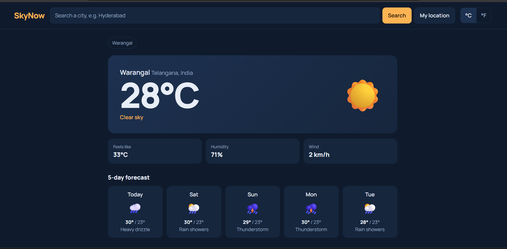

# SkyNow - Live Weather Dashboard



**Live demo:** https://skynow-weather-bay.vercel.app/

A responsive weather app built with plain HTML, CSS and JavaScript (ES modules). No frameworks, no API key.

## Features
- City search with live suggestions (debounced)
- Current weather: temperature, feels like, humidity, wind
- 5-day forecast
- °C / °F toggle
- "My location" using the Geolocation API
- Recent searches saved in localStorage
- Loading, empty and error states
- Responsive layout, keyboard focus styles, reduced-motion support

## Tech
HTML5, CSS3 (Grid, Flexbox, custom properties), JavaScript ES6+ (modules, async/await, Fetch API), Open-Meteo API.

## Run locally
ES modules need a server. In VS Code, right-click `index.html` and choose "Open with Live Server".
Or run: `npx serve .`

## Folder structure
```
index.html
css/style.css
js/app.js           app state and events
js/api.js           fetch calls
js/ui.js            rendering functions
js/storage.js       localStorage helpers
js/weatherCodes.js  weather code to label/icon
```
